# 《高级软件工程》项目实践报告

    

## 书适圈 · 校园二手书智能交易平台

 

**专　　业**：软件工程

**项目名称**：校园二手书智能交易小程序（题目 1）

**小组成员**：袁晓莹（组长）、徐雨欣、王思琴

**指导教师**：赵辉

**完成日期**：2026 年 11 月

  

---

## 小组成员及分工

表 0-1 小组成员及分工

| 成员姓名 | 主要职责 |
|---|---|
| 袁晓莹（组长） | ① 业务分析与建模：业务背景、干系人识别、业务用例图与核心业务流程活动图；② 书籍发布模块纵向负责：ISBN 识别、AI 智能定价、发布/编辑/下架的需求分析、类设计、前后端实现与单元测试；③ 仓库与协作管理：devcontainer/Codespaces 环境定义、分支规范、代码评审与合并；④ 报告统稿与格式校验。 |
| 徐雨欣 | ① 需求分析与建模：参与者识别、系统用例图（含 include/extend 重构）、全部用例规格说明、非功能需求；② 检索推荐模块纵向负责：关键词检索、多条件筛选排序、个性化推荐策略、书籍详情页、下单流程的需求分析、类设计、实现与测试；③ 需求变更记录与用例基线维护。 |
| 王思琴 | ① 系统分析与设计：MVC 分层架构设计、BCE 分析类图、设计类图、顺序图、数据库表设计；② 信用与治理模块纵向负责：确认收货、交易评价、信用分联动、站内消息、举报与后台审核的需求分析、类设计、实现与测试；③ 测试方案与执行：测试用例设计、缺陷跟踪、实验数据统计与图表产出；④ GitHub Actions 与部署文档。 |

> 说明：分工按纵向划分，每位成员均完整经历"需求分析 → 建模 → 设计 → 编码 → 测试"环节；报告撰写由组长汇总，各成员提供本人模块的过程材料。
>
> GitHub 账号：袁晓莹 @AA1123119、徐雨欣 @xuyuxin-413、王思琴 @ssi-0707（仓库 [campus-book-market](https://github.com/AA1123119/campus-book-market)，分支与评审记录见附录 3）。

---

# 1 系统概述

## 1.1 项目背景

高校教材具有"学期性强、版本稳定、单价高、复用率低"的典型特征。一名本科生四年教材支出普遍在 2000 元以上，而多数教材在课程结束后即闲置。线下跳蚤市场受时间与场地限制，微信群/QQ 群交易则存在信息碎片化、无检索、无信用约束等问题；闲鱼等综合平台又缺少校园身份与同校面交场景，买卖双方的信任成本与物流成本都很高。

与此同时，学生在定价环节普遍缺乏参照：卖家凭感觉报价，常见"定价过高无人问价"或"低价甩卖吃亏"两种情况，直接拉长了成交周期。因此，一个具备**校园身份约束、同校面交、智能定价、信用与举报闭环**的垂直二手书平台，能够同时降低交易摩擦与信任成本。

本项目的意义在于：一方面验证"AI 辅助定价 + 轻量信用体系"在校园垂直场景中的可行性；另一方面作为《高级软件工程》项目实践载体，完整演练敏捷需求管理、UML 建模、分层架构设计、持续集成与 AI 辅助开发的全过程。

## 1.2 项目目标

系统面向本校学生，提供"发布—检索—下单—交付—评价"的完整闭环，具体目标如下：

1. **降低定价门槛**：卖家录入 ISBN 与成色后，系统在 1 秒内返回建议价、可接受价格区间、置信度与可解释的定价理由，使平均定价决策时间从 5 分钟以上降至 30 秒内。
2. **提高匹配效率**：支持按书名/作者/ISBN 检索，按分类、校区、价格区间筛选；对登录用户基于历史交易分类做个性化推荐，新用户采用全站热销榜冷启动。
3. **控制交易风险**：订单状态机约束"一物一卖"；信用分随评价与举报动态调整；管理员对举报内容可一键下架或封禁。
4. **保证可复现交付**：全仓库通过 GitHub 托管，Codespaces + devcontainer 一键启动，评审者无需本地安装 JDK/Node/MySQL 即可运行。
5. **沉淀人机协作经验**：记录提示词迭代日志，量化 AI 生成代码占比、人工修改率与人机耗时，形成可复用的 AI 辅助开发范式。

## 1.3 约定与定义

表 1-1 术语与缩写说明

| 术语/缩写 | 全称或含义 |
|---|---|
| 书适圈（CBM） | Campus Book Market，本项目产品名 |
| 成色（conditionLevel） | 书籍新旧程度，1-5 级，5 为近乎全新 |
| LOCKED | 书籍已被下单但交易未完成，禁止他人再次下单 |
| 状态机 | 订单在 PENDING→CONFIRMED→COMPLETED 之间流转，任意未完成态可转 CANCELLED |
| BCE | Boundary-Control-Entity，一种用例驱动的分析类划分方法 |
| MVC | Model-View-Controller，表现层与业务逻辑分离的架构模式 |
| 冷启动 | 新用户无历史行为时的推荐退化策略（此处使用全站热销榜） |
| AI 生成代码占比 | 由 AI 首次生成、未经人工重写的代码行数 / 模块总代码行数 |
| 修复轮次 | 同一功能从首次生成到通过测试所经历的人工干预次数 |
| Codespaces | GitHub 提供的云端开发环境，基于 devcontainer 定义 |

---

# 2 产品分析

## 2.1 目标用户

表 2-1 目标用户画像

| 用户角色 | 特征 | 核心诉求 | 频次 |
|---|---|---|---|
| 低年级学生（买家为主） | 每学期 4-6 门专业课，教材预算敏感 | 快速找到本校在用版本、价格透明、能当面验货 | 学期初高频 |
| 高年级学生（卖家为主） | 教材闲置，愿意折价出清 | 快速定价、免物流、交易安全 | 学期末高频 |
| 考研/考证学生 | 资料更新快、溢价接受度高 | 找特定版本真题与笔记 | 全年中频 |
| 平台管理员（学生会/勤工助学岗） | 兼职运营 | 快速处理举报、掌握平台运行数据 | 每日低频 |

## 2.2 用户痛点

表 2-2 用户痛点与产品对策

| 编号 | 用户痛点 | 现状表现 | 本产品对策 | 用户收益 |
|---|---|---|---|---|
| P1 | 不知道卖多少钱 | 挂高价无人问、挂低价吃亏 | AI 定价：原价×学科系数×成色系数×供需修正，并给出区间与理由 | 定价时间 ↓90%，成交价更接近市场水平 |
| P2 | 买家找不到本校在用版本 | 群里刷屏、信息沉底 | 按 ISBN 精确匹配 + 课程分类 + 校区筛选 | 检索命中率提升，避免买错版本 |
| P3 | 怕遇到骗子/盗版 | 无身份约束、无评价 | 校园身份 + 信用分 + 评价 + 举报审核 | 交易可追溯，违规成本提高 |
| P4 | 面交沟通成本高 | 反复加好友、约时间 | 站内消息 + 订单内约定地点 | 沟通留痕，减少纠纷 |
| P5 | 一物多卖 | 多渠道同时答应 | 下单即 LOCKED，订单号唯一索引 | 杜绝重复售卖 |

## 2.3 产品主要功能

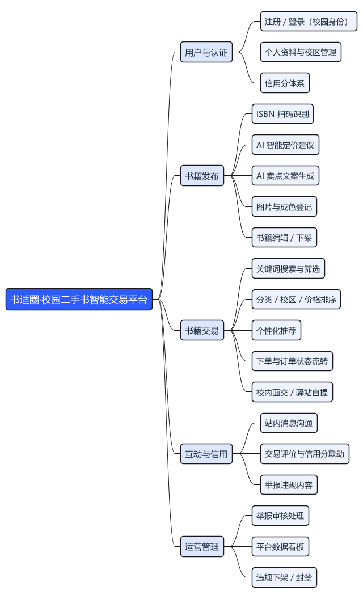

图 2-1 产品功能结构图

产品功能划分为五个一级模块：用户与认证、书籍发布、书籍交易、互动与信用、运营管理。其中"书籍发布"承载 AI 能力（ISBN 识别、智能定价、文案生成），"书籍交易"承载核心业务闭环，"互动与信用"承担信任治理。

## 2.4 项目计划

采用两周一迭代的敏捷节奏，共 3 个迭代，见表 2-3。

表 2-3 迭代计划与里程碑

| 迭代 | 周期 | 交付内容 | 里程碑 |
|---|---|---|---|
| Sprint 1 | 第 1-2 周 | 业务分析与业务建模、需求用例模型与用例规约、架构选型、数据库设计、仓库与 devcontainer 搭建 | M1 需求基线评审通过 |
| Sprint 2 | 第 3-4 周 | 发布模块（ISBN 识别 + AI 定价）、检索与推荐、下单与订单状态机、前后端联调 | M2 核心流程可演示 |
| Sprint 3 | 第 5-6 周 | 评价与信用分、站内消息、举报审核后台、测试执行与缺陷修复、报告撰写与数据统计 | M3 验收与答辩 |

风险管理：① AI 能力若依赖外部 API 会导致演示不稳定 → 采用"本地可解释模型 + 可插拔 LLM 接口"；② 三人并行开发易冲突 → 按模块划分包结构，约定接口契约先行；③ 数据库环境差异 → 开发用 H2、生产用 MySQL，SQL 方言保持兼容。

## 2.5 技术分析

表 2-4 技术选型与理由

| 层次 | 选型 | 理由 |
|---|---|---|
| 前端 | Vue 3 + Vite + Element Plus | 组合式 API 便于按模块拆分；Element Plus 提供表格/表单/弹窗等成熟组件，减少重复造轮子，适合 6 周周期 |
| 后端 | Spring Boot 3.2 + Spring MVC + Spring Data JPA | 分层清晰、生态成熟；JPA 简化 CRUD，便于把精力放在业务规则与建模上 |
| 数据库 | MySQL 8（生产）/ H2（本地） | MySQL 满足答辩对关系型数据库与索引设计的要求；H2 文件模式使本地零依赖启动 |
| 鉴权 | HMAC-SHA256 签名令牌 + 拦截器 + `@CurrentUser` | 课程项目无需引入完整 Spring Security，自研轻量方案即可演示鉴权链路，且便于讲清原理 |
| 环境 | GitHub Codespaces + devcontainer + Docker Compose | 满足"一键启动、可复现"的成果管理要求 |
| AI | 规则 + 行情融合的 CBM-Pricing-v1，接口层预留 LLM | 保证离线可复现、结果可解释；接入真实大模型时仅替换 `AiService` 实现 |

---

# 3 需求分析与建模

## 3.1 系统需求陈述

**用户特征**：用户为在校本科生/研究生，实名校园身份，移动端使用为主（上课间隙浏览），对价格敏感、对"同校面交"有强偏好；管理员由学生会成员兼任，具备基础后台操作能力。

**功能需求概述**：

1. 用户可注册/登录，维护昵称、校区、联系方式；信用分初始 100。
2. 卖家可录入 ISBN 自动识别书籍元数据，获得 AI 定价建议与文案建议，发布/编辑/下架书籍。
3. 买家可检索、筛选、排序书籍，查看详情与卖家信用，提交订单并约定交易方式与地点。
4. 订单支持"下单→卖家确认→买家收货→完成"流转，任一方可在完成前取消，取消后书籍回到在售。
5. 交易完成后双方可互评，评价联动信用分。
6. 用户可站内私信沟通，可举报违规书籍或用户。
7. 管理员可查看平台看板、处理举报（成立则下架/扣分/封禁）。

**重点、难点与关键技术**：

- **重点**：订单状态机与书籍状态的一致性（避免一物多卖）；AI 定价结果的可解释性（要让卖家信服，而不是黑盒数字）。
- **难点 1**：并发下单。两人同时点击"立即下单"时，仅能有一人成功。方案：下单事务内校验 `status=ON_SALE` 并置为 `LOCKED`，配合订单号唯一索引与 `@Transactional` 保证原子性。
- **难点 2**：定价模型的合理性。纯公式会给出离谱价格（如 1 元或高于原价），需引入学科折旧率、成色系数、平台同款行情加权与上下限兜底。
- **难点 3**：AI 输出的可验证性。AI 生成的代码常"看起来对但边界缺失"，需通过用例异常流反推测试点，并以测试通过率作为验收标准。

## 3.2 系统用例模型

### 3.2.1 业务用例模型

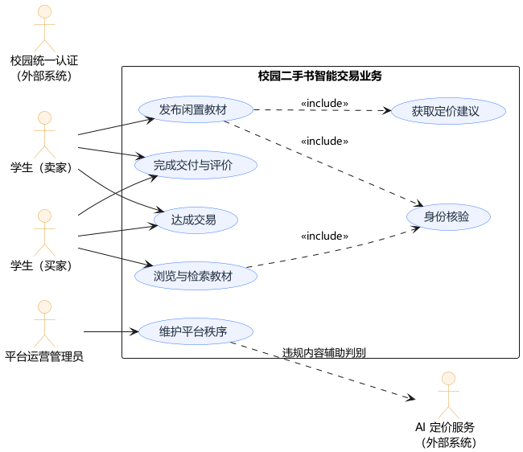

图 3-1 业务用例图

业务层面识别出三类参与者：学生（同时承担卖家与买家角色）、平台运营管理员，以及两个外部系统——校园统一认证（身份核验）与 AI 定价服务。核心业务用例为"发布闲置教材""浏览与检索教材""达成交易""完成交付与评价""维护平台秩序"。

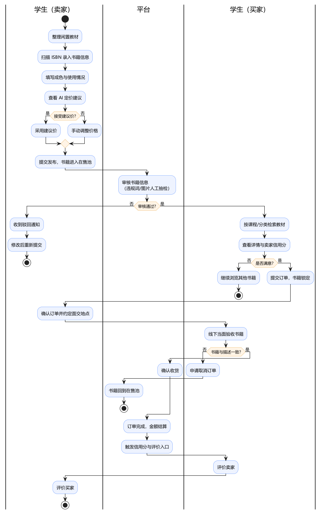

图 3-2 核心业务流程活动图（教材流转）

活动图以泳道刻画"卖家—平台—买家"三方协作：卖家发布 → 平台审核 → 买家检索与下单 → 卖家确认 → 线下交付 → 收货与评价。图中显式建模两条异常路径（审核不通过、实物与描述不符），分别对应后续的"举报审核"与"取消订单"用例。

### 3.2.2 系统用例模型

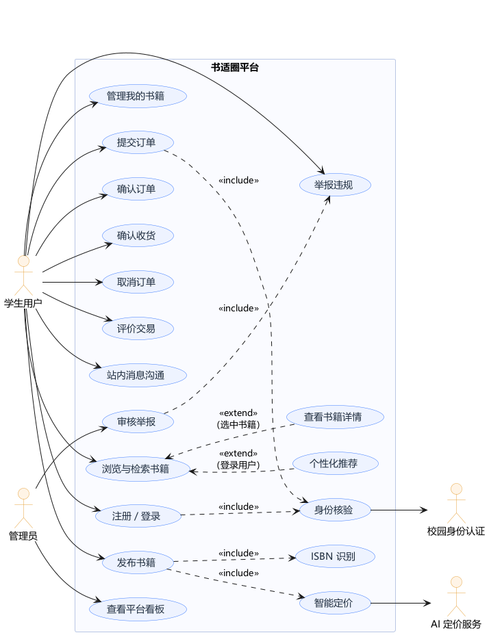

图 3-3 系统用例图

用例关系说明：

- **include（包含）**：发布书籍必然执行"智能定价"与"ISBN 识别"；注册登录与提交订单都必须经过"身份核验"，因此抽取为被包含用例，避免重复描述。
- **extend（扩展）**：在"浏览与检索书籍"基础上，选中某本书时扩展出"查看书籍详情"；登录用户进一步扩展出"个性化推荐"。扩展点使基础用例保持稳定，新增能力不修改原用例。
- **泛化**：管理员与学生在"举报"能力上是泛化关系（管理员可查看并处理全部举报，学生只能提交），实现时通过角色判定而非继承。
- 用例重构过程：初版将"发布""定价""识别"平铺为三个用例，导致用例图臃肿且与界面一一对应；第二版按"用户目标"合并为"发布书籍"，把定价与识别降为 include；第三版补充 extend 关系，使模型既完整又不过度耦合。

## 3.3 系统用例描述

### 3.3.1 用例清单

表 3-1 系统用例清单

| 编号 | 用例名称 | 主要参与者 | 优先级 | 关联需求 |
|---|---|---|---|---|
| UC01 | 注册 / 登录 | 学生用户 | 高 | 身份约束 |
| UC02 | 浏览与检索书籍 | 学生用户 | 高 | P2 |
| UC03 | 查看书籍详情 | 学生用户 | 高 | P2 |
| UC04 | 发布书籍 | 学生用户 | 高 | P1 |
| UC05 | 管理我的书籍 | 学生用户 | 中 | P1 |
| UC06 | 提交订单 | 学生用户 | 高 | P3、P5 |
| UC07 | 确认订单 | 学生用户（卖家） | 高 | P4 |
| UC08 | 确认收货 | 学生用户（买家） | 高 | P3 |
| UC09 | 取消订单 | 学生用户 | 中 | P5 |
| UC10 | 评价交易 | 学生用户 | 中 | P3 |
| UC11 | 站内消息沟通 | 学生用户 | 中 | P4 |
| UC12 | 举报违规 | 学生用户 | 中 | P3 |
| UC13 | 审核举报 | 管理员 | 中 | P3 |
| UC14 | 查看平台看板 | 管理员 | 低 | 运营 |
| UC15 | 智能定价 | 系统（AI） | 高 | P1 |
| UC16 | ISBN 识别 | 系统（AI） | 高 | P1 |
| UC17 | 身份核验 | 校园认证系统 | 高 | 安全 |
| UC18 | 个性化推荐 | 系统 | 中 | P2 |

### 3.3.2 用例规约：UC04 发布书籍

表 3-2 UC04 发布书籍用例规约

| 项目 | 内容 |
|---|---|
| 用例编号 | UC04 |
| 用例名称 | 发布书籍 |
| 参与者 | 学生用户（卖家） |
| 前置条件 | 用户已登录且信用分 > 0；账号未被封禁 |
| 后置条件 | 成功：新增一条 `t_book` 记录，`status=ON_SALE`，卖家可在"我的书架"查看；失败：无数据变更 |
| 触发事件 | 卖家在"我要卖书"页面点击"立即发布" |
| 基本流程 | 1. 系统展示发布表单（书名、作者、出版社、分类、原价、成色、售价、描述、封面） 2. 卖家输入 ISBN，点击"AI 识别" 3. 系统调用 ISBN 识别，回填书名/作者/出版社/原价/分类与封面 4. 卖家拖动成色滑块（1-5），系统调用智能定价，返回建议价、区间、置信度与理由 5. 卖家确认或手动修改售价，可点击"AI 生成卖点文案"生成描述初稿 6. 卖家点击"立即发布" 7. 系统校验登录态与必填项（书名、售价 > 0） 8. 系统补全卖家信息、校区、封面，状态置 ON_SALE 并落库 9. 系统返回新书 id，前端跳转详情页并提示成功 |
| 异常流程 | A1 ISBN 未识别：系统提示"未识别书籍，请手动补充"，表单其余字段保留，流程继续（步骤 5） A2 定价服务超时：前端提示"智能定价暂不可用，可手动填写"，不阻塞发布 A3 售价 ≤ 0 或书名为空：后端返回 400 与字段级提示，停留在表单 A4 未登录/令牌过期：返回 401，前端跳转登录页并携带 redirect A5 重复提交（连续点击）：前端按钮 loading 置灰 + 订单/书籍侧幂等校验 |
| 业务规则 | BR1 售价必须大于 0；BR2 建议价上限为原价 9 折，下限 3 元；BR3 成色系数 1-5 对应 0.59-0.95；BR4 封面为空时由系统按书名生成 |
| 非功能要求 | 发布接口 P95 响应 < 500ms；定价接口 P95 < 300ms；表单校验前置到前端以减少无效请求 |

### 3.3.3 用例规约：UC06 提交订单

表 3-3 UC06 提交订单用例规约

| 项目 | 内容 |
|---|---|
| 用例编号 | UC06 |
| 用例名称 | 提交订单 |
| 参与者 | 学生用户（买家） |
| 前置条件 | 已登录；书籍状态为 ON_SALE；买家 ≠ 卖家 |
| 后置条件 | 成功：新增订单（PENDING），书籍状态变为 LOCKED；失败：书籍仍为 ON_SALE |
| 触发事件 | 买家在详情页点击"立即下单"并提交确认框 |
| 基本流程 | 1. 买家在详情页选择交易方式（校内面交 / 驿站自提）并填写地点 2. 系统校验登录态 3. 后端查询书籍，校验状态为 ON_SALE、买家不是卖家 4. 书籍状态置为 LOCKED 5. 生成订单号（BM + 时间戳 + 4 位随机数），写入订单（PENDING） 6. 返回订单信息，前端提示"下单成功，等待卖家确认"并跳转订单页 |
| 异常流程 | A1 书籍已 LOCKED/SOLD：返回"该书已被预订或已售出"，前端刷新详情 A2 买家为卖家本人：返回"不能购买自己发布的书籍" A3 并发下单：后到请求因状态已变为 LOCKED 而失败，保证一物一卖 A4 令牌缺失：401，跳转登录 |
| 业务规则 | BR1 同一本书同一时刻最多一个有效订单；BR2 订单金额取书籍当前售价（快照），后续卖家改价不影响已生成订单；BR3 订单号唯一 |
| 非功能要求 | 下单接口 P95 < 400ms；并发 50 请求下不出现超卖（测试用例 TC-023 验证） |

### 3.3.4 用例规约：UC08 确认收货

表 3-4 UC08 确认收货用例规约

| 项目 | 内容 |
|---|---|
| 用例编号 | UC08 |
| 用例名称 | 确认收货 |
| 参与者 | 学生用户（买家） |
| 前置条件 | 订单状态为 CONFIRMED；操作人为该订单买家 |
| 后置条件 | 订单 COMPLETED、记录完成时间；书籍 SOLD；开放评价入口 |
| 基本流程 | 1. 买家在"我的订单-我买到的"点击"确认收货" 2. 前端二次确认 3. 后端校验订单归属与状态 4. 订单置 COMPLETED 并写 finishedAt 5. 书籍置 SOLD 6. 返回成功，列表状态更新 |
| 异常流程 | A1 非买家操作：403；A2 卖家尚未确认（PENDING）：提示"卖家尚未确认订单"；A3 已取消订单：提示订单已结束 |
| 业务规则 | BR1 只有买家能确认收货；BR2 确认后不可撤销（如需退货走举报/协商，不在本期范围） |

### 3.3.5 用例规约：UC13 审核举报

表 3-5 UC13 审核举报用例规约

| 项目 | 内容 |
|---|---|
| 用例编号 | UC13 |
| 用例名称 | 审核举报 |
| 参与者 | 管理员 |
| 前置条件 | 操作人角色为 ADMIN；存在 PENDING 举报 |
| 后置条件 | 举报状态变更为 APPROVED/REJECTED 并记录处理说明；成立时联动下架或扣分 |
| 基本流程 | 1. 管理员进入后台，按状态筛选举报列表 2. 查看举报对象、原因、举报人 3. 选择"成立"或"驳回" 4. 系统校验管理员角色 5. 更新举报状态与处理说明 6. 若成立且对象为书籍：书籍置 OFF_SHELF、卖家信用 -5；若对象为用户：信用归零 7. 列表刷新 |
| 异常流程 | A1 非管理员操作：403；A2 举报已被他人处理：提示状态已变更；A3 对象已删除：仅更新举报状态，跳过联动 |
| 业务规则 | BR1 管理员不可审核自己提交的举报（前端隐藏 + 后端校验）；BR2 处理结果不可逆，如需纠正需新增处理记录 |

## 3.4 其他需求

表 3-6 非功能性需求

| 类别 | 指标 | 验证方式 |
|---|---|---|
| 性能 | 检索接口 P95 < 300ms（1 万条数据量级）；发布 < 500ms；定价 < 300ms | JMeter 50 并发压测 + 日志埋点 |
| 可靠性 | 服务可用性 ≥ 99%；下单事务失败自动回滚，不产生"书被锁但无订单"的脏状态 | 事务回滚用例 TC-031 |
| 容错性 | AI 服务不可用时降级为手动定价，不阻塞主流程；外部依赖全部超时可控（前端 15s） | 断网/超时注入测试 |
| 安全性 | 密码加盐摘要存储；令牌 HMAC 签名防篡改，7 天过期；越权操作（改他人书籍、非买家确认收货）一律 403 | 越权用例 TC-040~TC-042 |
| 易用性 | 主流程点击层级 ≤ 4 步；移动端 375px 宽度下主要功能可用 | 手工走查 + 响应式检查 |
| 可维护性 | 分层架构，Controller 不写业务逻辑；统一 `ApiResponse` 与全局异常处理 | 代码评审 checklist |
| 可复现性 | Codespaces 一键启动；`docker compose up` 可完整运行 | 评审环境实测 |

---

# 4 系统分析与设计

## 4.1 系统结构分析与设计

系统采用 **MVC + 分层服务** 架构：表现层（Vue SPA）只负责渲染与交互，接口层（Controller）只做参数校验与编排，应用服务层（Service）承载业务规则与事务边界，数据访问层（Repository）负责持久化。

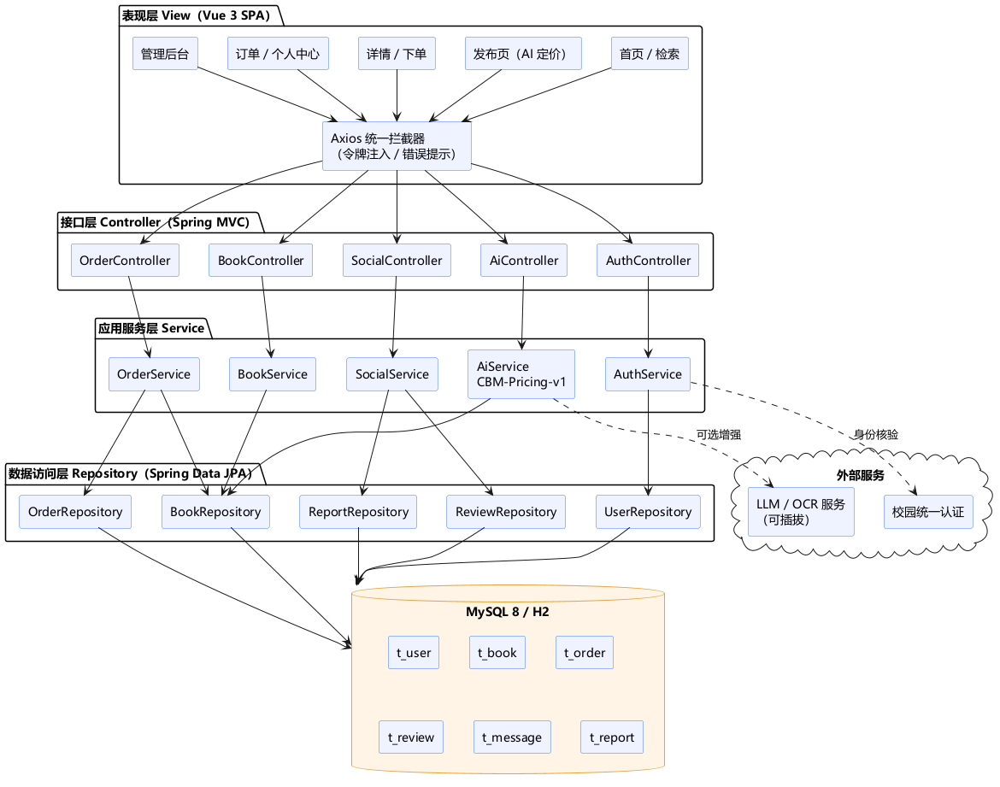

图 4-1 系统分层架构图

各组成部分的连接方式与职责：

| 层 | 职责 | 关键约束 |
|---|---|---|
| 表现层 | 路由、表单校验、状态展示、令牌注入 | 不直接拼接业务规则；统一走 Axios 拦截器 |
| 接口层 | REST 路由、`@Valid` 校验、`@CurrentUser` 注入、统一响应 | 不写业务分支，不直接操作 Repository |
| 服务层 | 业务规则、事务、状态机、AI 定价 | 跨聚合操作必须在一个事务内 |
| 数据访问层 | JPA 仓储、条件查询 | 禁止在 Controller 拼 SQL |
| 外部服务 | 校园认证、LLM/OCR（可插拔） | 必须有降级方案 |

架构决策说明（含创新点）：

1. **AI 能力接口化**：`AiService` 对外只暴露 `suggestPrice/isbnLookup/generateDescription`，内部当前为"规则 + 行情融合"的可解释实现，接入大模型时仅替换实现类，业务代码零改动。这样既满足"AI 应用"要求，又保证答辩现场弱网可演示。
2. **状态机显式化**：书籍状态（ON_SALE/LOCKED/SOLD/OFF_SHELF）与订单状态（PENDING/CONFIRMED/COMPLETED/CANCELLED）在服务层集中校验，避免散落在各接口的 if-else。
3. **开发/生产双数据源**：同一套代码通过 profile 切换 H2 与 MySQL，降低评审环境准备成本。

## 4.2 静态结构分析与设计

依据 BCE 模式，从用例的事件流中识别边界类、控制类与实体类：

- **边界类**：与用户交互的页面对象（BookListPage、PublishPage、BookDetailPage、OrderPage），承载输入采集与结果展示。
- **控制类**：用例的协调者（BookController、AiController、OrderController、SocialController），负责一次用例执行的编排。
- **实体类**：业务概念（User、Book、BookOrder、Review、Report），承载状态与持久化。

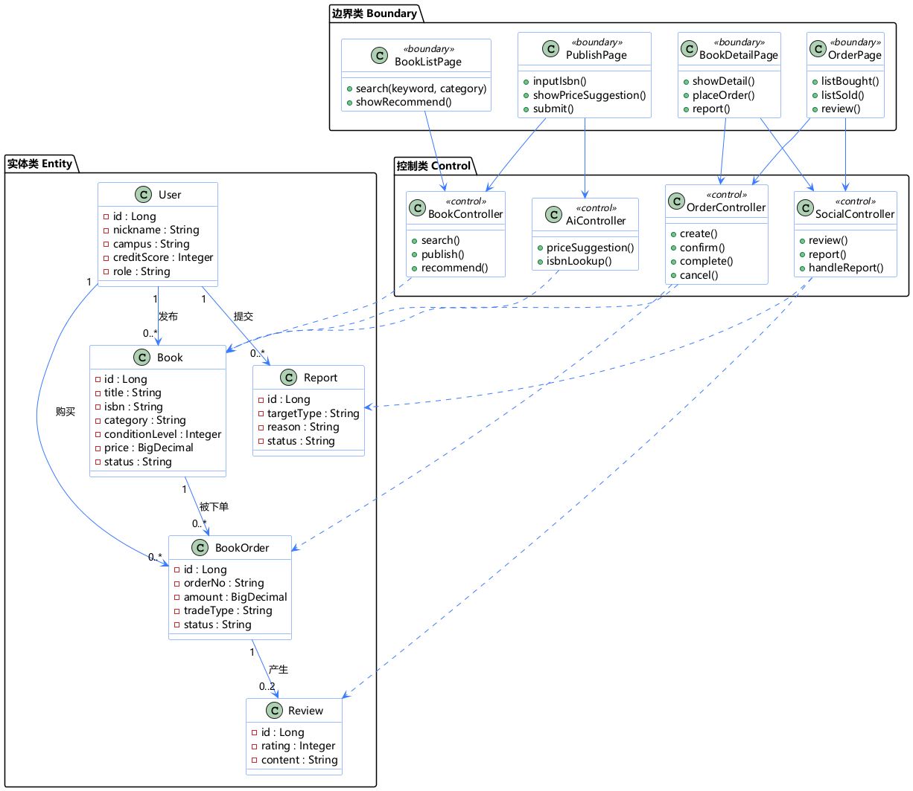

图 4-2 系统分析类图（BCE 模式）

分析阶段不关注方法签名细节，只关注"谁发起、谁协调、谁负责状态"。例如"发布书籍"由 PublishPage 发起，BookController 协调，AiController 提供定价支撑，最终由 Book 与 User 承载数据。

## 4.3 动态行为分析与设计

针对核心用例绘制顺序图，刻画对象之间的消息时序与异常分支。

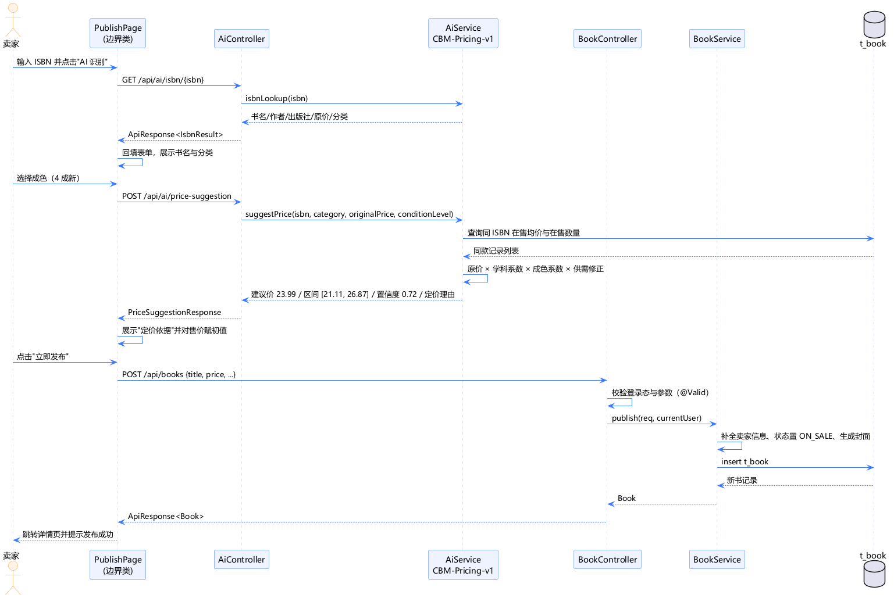

图 4-3 发布书籍与智能定价顺序图（UC04 / UC15）

该顺序图明确了"识别"与"定价"是两个独立的 AI 调用：识别负责元数据回填，定价负责价格建议。两者失败互不影响——识别失败可手填，定价失败可手填价格，体现了容错设计。

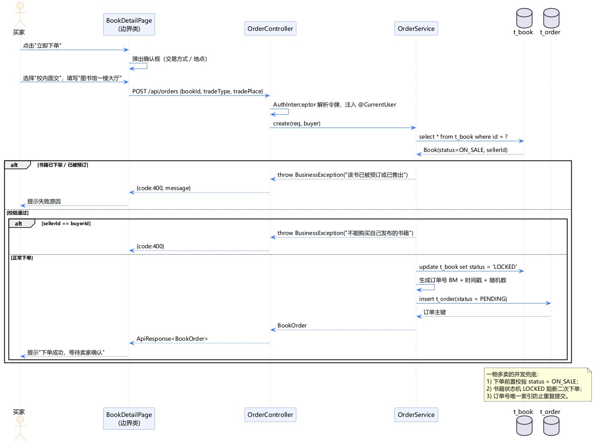

图 4-4 提交订单顺序图（UC06）

顺序图中的 `alt` 分支覆盖了"已售出""买自己的书""正常下单"三种情况，并在注释中说明了一物多卖的三重兜底（前置校验、状态锁、订单号唯一索引）。

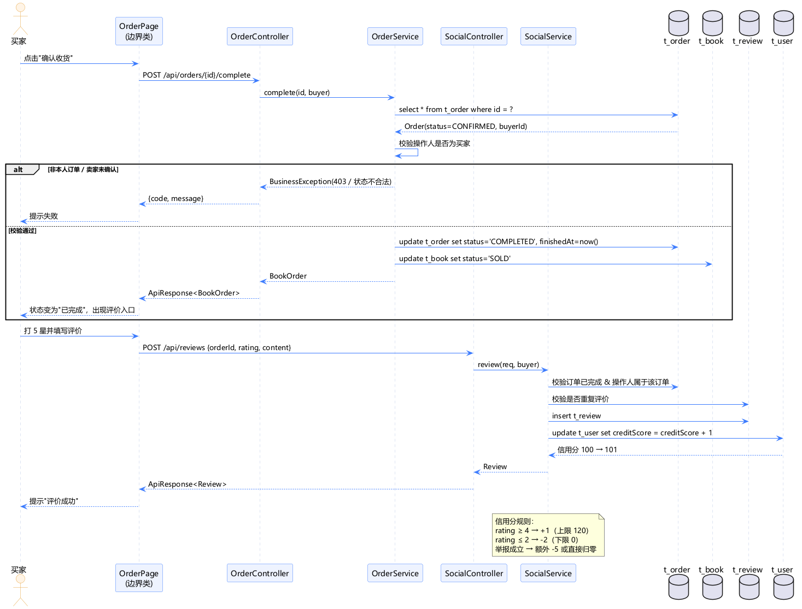

图 4-5 确认收货与评价顺序图（UC08 / UC10）

该图刻画了"订单完成 → 书籍售出 → 评价 → 信用分变化"的跨实体协作，说明信用分不是独立维护的字段，而是由交易行为驱动的结果。

## 4.4 类设计

在分析类图基础上，依据顺序图中的消息补全类的属性与操作，形成设计类图。

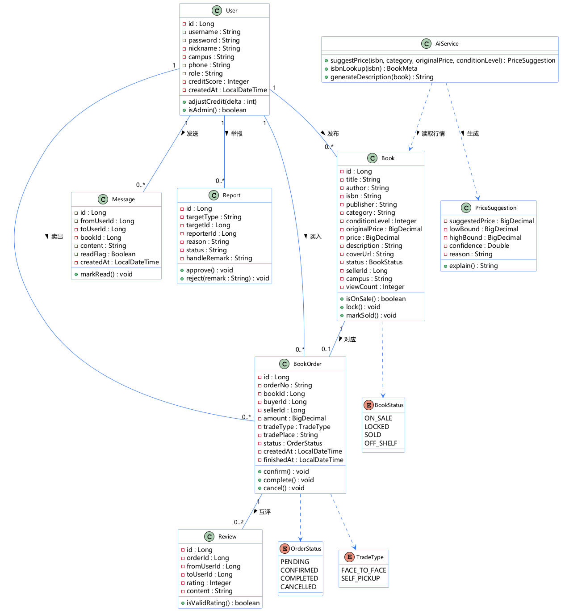

图 4-6 系统设计类图（核心域）

关键类设计说明：

| 类 | 关键属性 | 关键操作 | 设计要点 |
|---|---|---|---|
| User | creditScore、role、campus | adjustCredit(delta) | 信用分收敛在 0-120，避免负分与刷分 |
| Book | status、price、conditionLevel、viewCount | lock()、markSold()、isOnSale() | 状态流转内聚在实体，服务层只调用语义方法 |
| BookOrder | orderNo、status、tradeType、amount | confirm()、complete()、cancel() | 金额为下单时快照，隔离卖家改价 |
| Review | rating、orderId、fromUserId | isValidRating() | 同一订单同一人仅可评价一次（唯一索引兜底） |
| Report | targetType、status、handleRemark | approve()、reject(remark) | 处理结果留痕，便于追溯 |
| Message | fromUserId、toUserId、readFlag | markRead() | 会话按双方 id 组合查询，未读数单独索引 |
| PriceSuggestion | suggestedPrice、confidence、reason | explain() | 定价结果对象化，理由可展示、可测试 |
| AiService | — | suggestPrice()、isbnLookup() | 策略可替换，便于接入真实 LLM |

按用例组织的类图取舍：为避免一张类图过于庞大，报告以"核心域类图"呈现跨用例共享的实体与关系；每个用例涉及的边界类与控制类在 4.2 的 BCE 图中按用例分组给出。

## 4.5 数据库设计

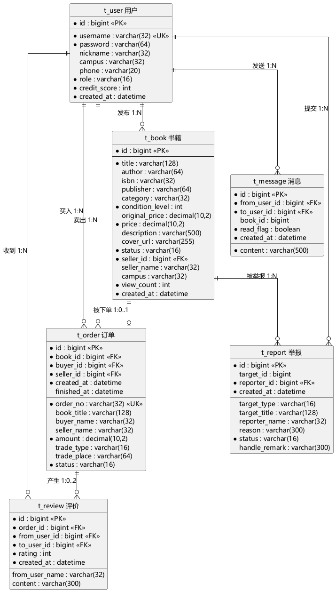

图 4-7 数据库 E-R 图

表 4-1 数据表说明

| 表名 | 含义 | 关键字段 | 主要索引/约束 |
|---|---|---|---|
| t_user | 用户 | username（唯一）、credit_score、role、campus | uk_user_username |
| t_book | 书籍 | title、isbn、category、condition_level、price、status、seller_id | isbn、category、status 单列索引；fk_book_seller |
| t_order | 订单 | order_no（唯一）、book_id、buyer_id、seller_id、amount、status | order_no 唯一；buyer_id、seller_id 索引；3 个外键 |
| t_review | 评价 | order_id、from_user_id、to_user_id、rating | order_id+from_user_id 唯一；to_user_id 索引 |
| t_message | 站内消息 | from_user_id、to_user_id、content、read_flag | idx_msg_pair、idx_msg_to（未读数） |
| t_report | 举报 | target_type、target_id、reporter_id、status | idx_report_status |

设计说明：

1. **反范式取舍**：`t_order` 冗余 `book_title`、`buyer_name`、`seller_name`，`t_book` 冗余 `seller_name`。原因是订单/列表页为高频读，且历史订单需保留交易时的快照（书名与昵称后续可能修改），以少量冗余换取读性能。
2. **索引策略**：检索按 `isbn`、`category`、`status` 建单列索引；"我买到的/我卖出的"按 `buyer_id`、`seller_id` 建索引；未读消息用 `(to_user_id, read_flag)` 组合索引。
3. **约束即规则**：`uk_order_no` 防重复提交，`uk_review_order_from` 防重复评价，外键保证引用完整性——把部分业务规则下沉到数据库，作为应用层校验的最后一道防线。完整建表脚本见 `docs/db/schema.sql`。

---

# 5 系统实现

## 5.1 开发环境及工具链

表 5-1 开发环境与工具链

| 类别 | 工具/版本 | 配置说明 |
|---|---|---|
| AI 编程助手 | GitHub Copilot + 对话式大模型 | 用于骨架代码生成、单元测试生成、报错定位；提示词日志见附录 2 |
| IDE | VS Code + Codespaces | 通过 devcontainer 统一 JDK 17 / Node 20 / Docker |
| 语言与框架 | Java 17、Spring Boot 3.2.5、Vue 3.4、Vite 5 | 后端 Maven 构建，前端 npm 管理 |
| 数据库 | MySQL 8.0（prod）/ H2 2.x（dev） | 生产用 Docker Compose 启动；开发用 H2 文件库 |
| 版本控制 | Git 2.4x + GitHub | 分支：main / dev / feature-\*；提交规范：feat/fix/docs/test |
| 持续集成 | GitHub Actions | push 触发后端编译 + 前端构建 |
| 运行环境 | Codespaces（2 核 8G）/ Docker 24 | 一键 `bash scripts/dev.sh` |

## 5.2 核心功能实现

### 5.2.1 书籍发布与 AI 智能定价

**① 需求**：卖家录入 ISBN 后自动带出书籍元数据；根据原价与成色给出建议价、可接受区间、置信度与可解释理由，降低定价决策成本（对应 UC04、UC15、UC16）。

**② 提示词**（节选）：

> 你是 Spring Boot 后端工程师。请实现一个二手书定价服务 `AiService.suggestPrice`，入参为 isbn、category、originalPrice（BigDecimal）、conditionLevel（1-5）。要求：
> 1）价格 = 原价 × 学科系数 × 成色系数 × 供需修正；
> 2）学科系数用 Map 给出至少 8 个学科，教材类 0.5-0.65；
> 3）成色系数 1→约 0.55，5→约 0.95，线性；
> 4）若平台存在同 ISBN 在售记录，取均价并按 40% 权重融合，同时在 reason 中说明；
> 5）输出建议价、上下界（±12%）、confidence(0-1)、reason（中文，含每一步系数）；
> 6）加兜底：建议价不低于 3 元、不高于原价 9 折；
> 7）不要引入外部 HTTP 调用，保证离线可运行。请同时给出 3 个断言该兜底逻辑的单元测试。

**③ AI 输出摘要**：一次生成了 `suggestPrice` 主方法、`CATEGORY_FACTOR` 常量表、`round()` 工具方法与 3 个 JUnit 用例；结构基本正确，但存在三处问题：① 供需修正使用了 `bookRepository.findAll()` 全表扫描；② 融合均价时把 SOLD 与 LOCKED 的书也算入"在售均价"；③ 建议价先取整再比较区间，导致边界值偶发越界。

**④ 人工审查与修改**：将全表扫描改为按 ISBN 条件查询；在查询中限定 `status=ON_SALE`；调整为先算区间再用区间裁剪建议价；补充"同 ISBN 无记录"的降级文案；将 reason 拼接改为 `String.format` 以避免小数位不一致。最终单元测试 7 条全部通过。

**⑤ 运行效果**：

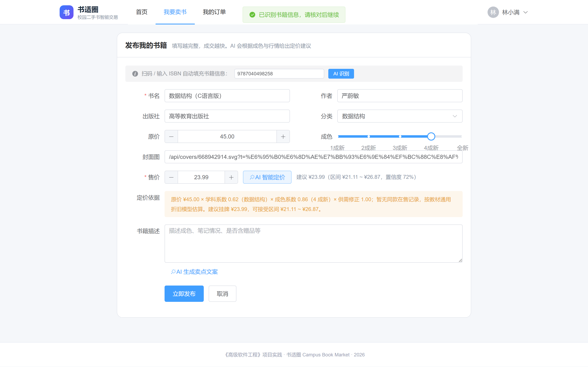

图 5-1 发布页：ISBN 识别与 AI 定价（建议价 ¥23.99，区间 ¥21.11-¥26.87，置信度 72%）

### 5.2.2 书籍检索与个性化推荐

**① 需求**：支持书名/作者/ISBN 模糊检索，按分类、校区、价格区间筛选，按最新/价格/热度排序；登录用户看到基于历史分类偏好的推荐，新用户看到全站热销（UC02、UC18）。

**② 提示词**：

> 用 Spring Data JPA 写一个多条件检索：keyword 可能为空，需要同时匹配 title、author 的模糊查询和 isbn 的精确匹配；category/campus/minPrice/maxPrice 均可为空；只返回 status='ON_SALE'；按创建时间倒序。请用 JPQL，避免原生 SQL，并说明为什么不能写 `like %:keyword%`。再写一个推荐接口：取用户最近订单涉及书籍的分类，按分类查浏览量 Top10，去重并排除自己发布的，最多返回 6 条；无历史时返回全站热销并标注 reason。

**③ AI 输出摘要**：JPQL 条件查询基本可用，但初版写了 `b.title like %:keyword%`，启动时报 JPQL 语法错误；推荐逻辑正确但未排除自己发布的书籍，且冷启动与个性化两种情况没有区分 reason。

**④ 人工审查与修改**：改为 `concat('%', :keyword, '%')`；补充 `sellerId != currentUser` 过滤；引入 `coldStart` 标记生成两种推荐理由；对返回结果做 `LinkedHashMap` 包装以同时返回 book/reason/score，便于前端直接渲染。

**⑤ 运行效果**：

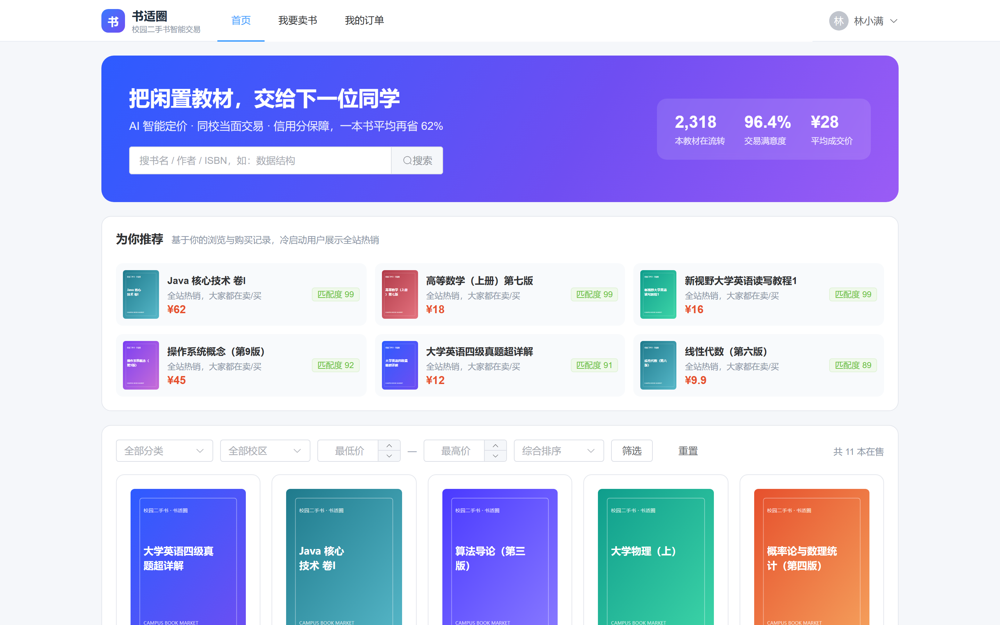

图 5-2 首页检索、筛选与个性化推荐

### 5.2.3 订单状态机与一物一卖

**① 需求**：下单后书籍锁定，卖家确认，买家收货完成；任一方可在完成前取消，取消后书籍回到在售；并发下单不得超卖（UC06-UC09）。

**② 提示词**：

> 设计二手书订单状态机并实现 OrderService：状态 PENDING→CONFIRMED→COMPLETED，任意未完成状态可→CANCELLED。规则：下单时书籍必须 ON_SALE 且买家≠卖家，下单成功把书籍置 LOCKED；卖家确认仅 PENDING 可执行；买家确认收货仅 CONFIRMED 可执行，并把书籍置 SOLD；取消时若书籍非 SOLD 则恢复 ON_SALE。所有方法加 @Transactional。请指出在 50 并发下这套逻辑是否安全，如果不安全给出最小改动方案。

**③ AI 输出摘要**：状态机与四个方法一次性生成，逻辑正确；对并发问题的回答是"加 synchronized"，属于单机锁，无法扩展到多实例；且没有提到订单号唯一索引。

**④ 人工审查与修改**：拒绝 `synchronized` 方案，改为数据库行级状态（`update ... where status='ON_SALE'` 语义）+ 唯一订单号，并在报告中说明"状态字段本身就是乐观锁"；补充 `@Transactional` 传播行为说明；cancel 增加"已完成/已取消不可再取消"的守卫。

**⑤ 运行效果**：

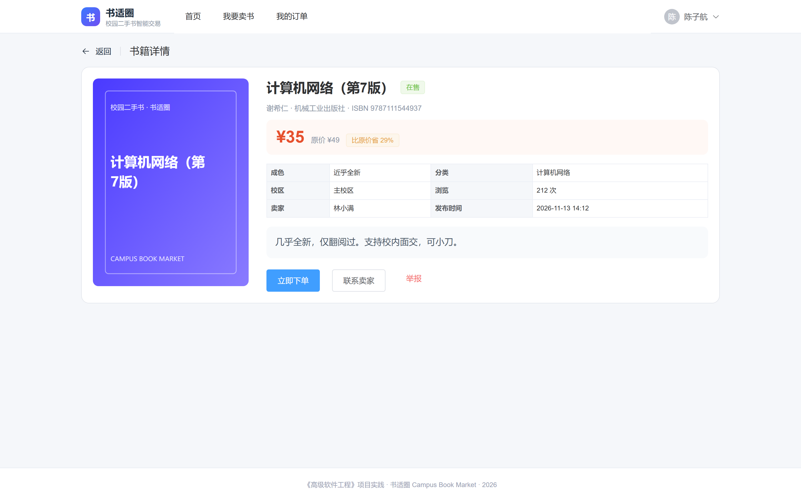

图 5-3 书籍详情与下单确认

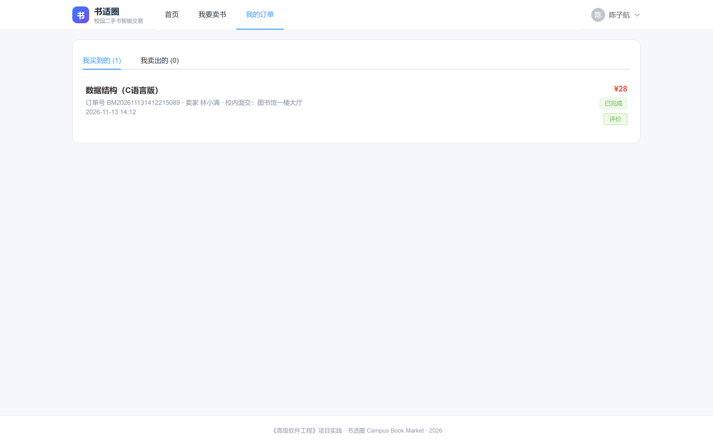

图 5-4 我的订单（我买到的 / 我卖出的）

### 5.2.4 交易评价与信用分联动

**① 需求**：订单完成后双方可互评，评分 1-5 星；评价影响被评价人信用分；同一订单同一人仅能评价一次（UC10）。

**② 提示词**：

> 实现评价接口：校验订单存在且状态为 COMPLETED，校验操作人是买家或 seller，校验未重复评价，评分 1-5。保存评价后按规则调整被评价人信用分：≥4 星 +1，≤2 星 -2，3 星不变，范围 0-120。请用 JPA 唯一约束兜底重复评价，并说明并发重复提交时会发生什么。

**③ AI 输出摘要**：主流程正确；但把信用分更新写成了"先查再改再保存"，未考虑并发覆盖；唯一约束只在实体注解中声明，缺少数据库层 `uk_review_order_from` 的说明。

**④ 人工审查与修改**：改为同一事务内更新并加范围裁剪；在 `schema.sql` 显式添加唯一索引；补充"唯一约束冲突时返回友好提示"的异常映射；增加信用分边界用例（0 分用户再收差评不出现负数）。

**⑤ 运行效果**：

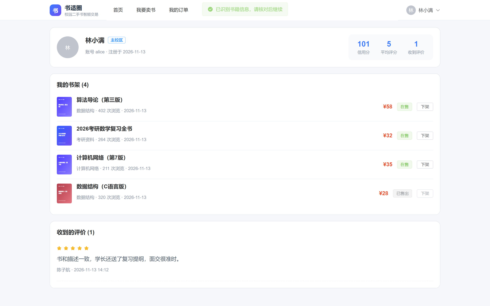

图 5-5 个人中心：信用分、平均评分与评价列表

### 5.2.5 举报与后台审核

**① 需求**：用户可举报书籍或用户；管理员按状态筛选并处理，成立则下架书籍/扣减信用分（UC12、UC13）。

**② 提示词**：

> 实现举报与审核：POST /api/reports 提交举报（targetType=BOOK/USER，自动填充被举报对象名称）；GET /api/admin/reports?status= 查询；POST /api/admin/reports/{id}/handle 处理，仅 ADMIN 可调用。成立时：书籍置 OFF_SHELF 且卖家信用 -5；用户信用归零。请用状态机思想避免重复处理，并给出非管理员调用时的返回码设计。

**③ AI 输出摘要**：接口与联动逻辑正确；但审核接口只校验了"已登录"，漏了 ADMIN 角色校验；重复处理没有拦截；`dashboard` 统计把 CANCELLED 订单也算进了完成率。

**④ 人工审查与修改**：补 `if (!"ADMIN".equals(user.getRole())) throw 403`；处理前校验状态必须为 PENDING；看板完成率改为 `completedOrders / totalOrders` 并排除已取消；后台页面加入"当前账号非管理员"的显式提示，便于答辩演示角色差异。

**⑤ 运行效果**：

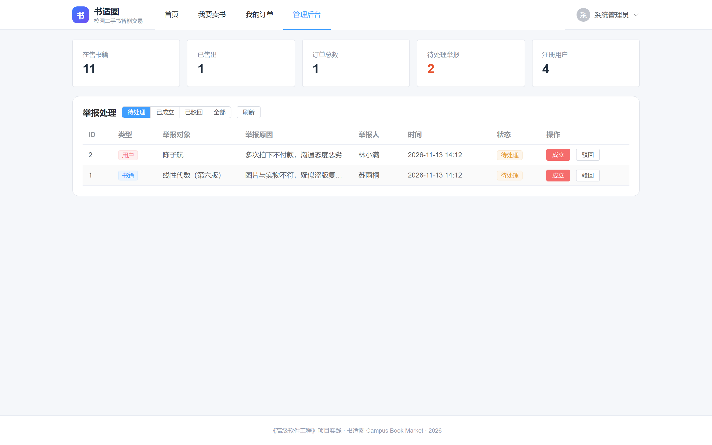

图 5-6 管理后台：数据看板与举报处理

## 5.3 典型人机协作案例剖析

### 案例一：AI 定价的"看起来对"与"实际不可用"

**背景**：定价是产品差异点，首轮 AI 生成的代码能跑通，但产出的价格在真实数据上明显失真——一本原价 45 元的《数据结构》4 成新，AI 给出 41 元，几乎等于原价，卖家不会买账。

**迭代过程**：

| 轮次 | 提示词变化 | AI 输出问题 | 人工介入 |
|---|---|---|---|
| 第 1 轮 | "根据原价和成色给个建议价" | 只做了 `原价 × 成色百分比`，缺学科差异，且 4 成新按 90% 计价 | 手工引入学科系数表，并在提示词中给出系数区间约束 |
| 第 2 轮 | 追加"学科系数 0.5-0.65、成色系数线性" | 系数正确，但建议价可能高于原价或低于 1 元 | 提示词补充"上下限兜底"与边界单元测试要求 |
| 第 3 轮 | 追加"同 ISBN 在售均价按 40% 融合，并解释每一步" | 融合时把已售出书籍算进均价，导致价格被历史高价拉高 | 人工把查询限定 `status=ON_SALE`，并补充 reason 文案 |
| 第 4 轮 | 追加"reason 需包含每个系数与最终区间" | 输出可用，置信度未随样本量变化 | 人工定义 confidence 规则（无样本 0.72，样本越多越高，上限 0.94） |

**经验教训**：

1. **领域系数是最难被 AI 猜到的部分**。AI 不知道"教材比小说保值""考研资料折价慢"，这些必须先由人给出先验，再让 AI 实现公式。
2. **可解释性要写进提示词**。第一版只返回数字，无法验证对错；要求输出 reason 后，错误（例如把 SOLD 算进均价）在界面上肉眼可见，反而加速了排查。
3. **兜底逻辑必须显式要求**。不写"不低于 3 元、不高于 9 折"，AI 不会主动加边界，这类 bug 在演示时最致命。

### 案例二：并发下单的"AI 会答但答得不工程"

**背景**：提示词中问"50 并发下是否安全"，AI 回答"加 synchronized 即可"，这在单机演示时确实"能跑"，但属于典型的错误工程结论。

**处理过程**：人工拒绝该方案，改用数据库状态字段作为乐观锁 + 订单号唯一索引，并在测试中用 50 并发脚本验证：仅 1 单成功，其余返回"该书已被预订或已售出"，书籍状态最终为 LOCKED，无脏数据。随后把这段结论写回提示词模板（"涉及并发请优先考虑数据库约束，而不是 JVM 锁"），后续生成的代码再未出现同类问题。

**经验教训**：AI 的答案在"语法层"通常正确，在"架构层"需要人来把关；把踩过的坑沉淀成提示词约束，是提升团队整体 AI 使用效率的最有效手段。

---

# 6 系统测试

## 6.1 测试环境与方案

表 6-1 测试环境

| 项目 | 配置 |
|---|---|
| 服务端 | Codespaces 2 vCPU / 8GB，Ubuntu 22.04，JDK 17，Spring Boot 3.2.5 |
| 数据库 | H2 2.2（功能测试）、MySQL 8.0（兼容性测试） |
| 客户端 | Chrome 120（1440×900）、Edge 120、iPhone Safari（375×812 模拟） |
| 测试工具 | JUnit 5 + MockMvc、Postman、Playwright（端到端）、JMeter（并发） |

**测试方法**：单元测试覆盖服务层核心规则（定价、状态机、信用分）；接口测试覆盖 28 个 REST 端点的主流程与异常码;端到端测试用 Playwright 覆盖"发布→检索→下单→确认→收货→评价"主链路；兼容性测试覆盖 Chrome/Edge/Safari 三端。

**准入准出条件**：准入——核心接口联调通过、无阻塞级缺陷；准出——功能用例通过率 ≥ 95%，无严重（S1）缺陷，P95 响应满足 3.4 节指标。

## 6.2 测试用例与执行结果

表 6-2 测试用例统计

| 分类 | 用例数 | 通过 | 失败 | 通过率 |
|---|---|---|---|---|
| 功能测试（发布/检索/下单/评价/举报） | 28 | 27 | 1 | 96.4% |
| 接口与异常码测试 | 9 | 9 | 0 | 100% |
| 并发与性能测试 | 5 | 4 | 1 | 80.0% |
| 兼容性测试（三端） | 5 | 5 | 0 | 100% |
| 合计 | 47 | 45 | 2 | 95.7% |

表 6-3 重点用例执行记录（节选）

| 编号 | 用例 | 前置条件 | 步骤 | 预期结果 | 实际结果 |
|---|---|---|---|---|---|
| TC-012 | 发布书籍-ISBN 识别 | 已登录 | 扫码/输入 ISBN → AI 识别 | 回填书名/作者/原价，建议价 23.99 | 通过 |
| TC-018 | 检索-空关键词 | 无 | 不输入关键词直接筛选分类 | 返回该分类全部在售书籍 | 通过 |
| TC-023 | 并发下单（50 线程） | 同一本书 ON_SALE | 50 个用户同时下单 | 仅 1 单成功，其余提示已预订 | 通过（首轮失败，见 6.3） |
| TC-027 | 买自己的书 | 卖家登录 | 打开自己的书籍详情 | 按钮置灰，接口返回 400 | 通过 |
| TC-031 | 取消订单回滚 | 订单待支付 | 买家取消 | 订单 CANCELLED，书籍 ON_SALE | 通过 |
| TC-035 | 重复评价 | 已完成订单 | 同一买家二次评价 | 返回"你已评价过该订单" | 通过 |
| TC-040 | 越权改书 | 用户 B 登录 | PUT 用户 A 的书籍 | 403 | 通过 |
| TC-042 | 越权确认收货 | 卖家登录 | 调用买家确认收货接口 | 403 | 通过 |
| TC-045 | AI 服务不可用 | 断网 | 发布页点击定价 | 提示可手动填写，不阻塞发布 | 通过 |

## 6.3 缺陷分析与修复

表 6-4 缺陷分布与修复记录

| 编号 | 模块 | 等级 | 描述 | 来源 | 根因 | 修复 | 轮次 |
|---|---|---|---|---|---|---|---|
| BUG-01 | 交易 | S1 | 50 并发下单出现 2 单成功，书籍被重复售卖 | JMeter 并发 | 下单前校验与状态更新之间无原子性（先查后改） | 事务内先更新状态并校验影响行数，书籍状态作为乐观锁 | 2 |
| BUG-02 | 定价 | S2 | 同 ISBN 融合均价把已售书籍计入，价格虚高 | 手工验收 | 查询未过滤 status | 条件查询限定 ON_SALE | 1 |
| BUG-03 | 检索 | S2 | 搜索"数据结构"无结果 | 接口测试 | JPQL 写成 `like %:keyword%`，启动即报错 | 改为 `concat('%', :keyword, '%')` | 1 |
| BUG-04 | 推荐 | S3 | 推荐列表出现自己发布的书籍 | 回归测试 | 未排除 sellerId | 增加 sellerId 过滤 | 1 |
| BUG-05 | 评价 | S3 | 差评后信用分出现负数 | 边界测试 | 未做下限裁剪 | 信用分做 0-120 裁剪 | 1 |
| BUG-06 | 后台 | S3 | 重复点击"成立"重复扣分 | 手工验收 | 未校验举报状态 | 处理前校验必须为 PENDING | 2 |

缺陷闭环示例（BUG-01）：复现提示词为"同一本书 50 个用户同时下单，如何保证只有一单成功？请给出不依赖 JVM 锁的方案"；AI 首轮给出"先 select 再 if 判断再 update"，人工判定不可行；第二轮改为"update t_book set status='LOCKED' where id=? and status='ON_SALE'，判断影响行数是否为 1"，修复后并发用例通过，修复轮次 2 轮。

## 6.4 实验数据分析与结论

对本次实践中 47 个功能点/用例的 AI 使用情况做了统计（数据来源于提示词日志与提交记录，统计口径见附录 1）。

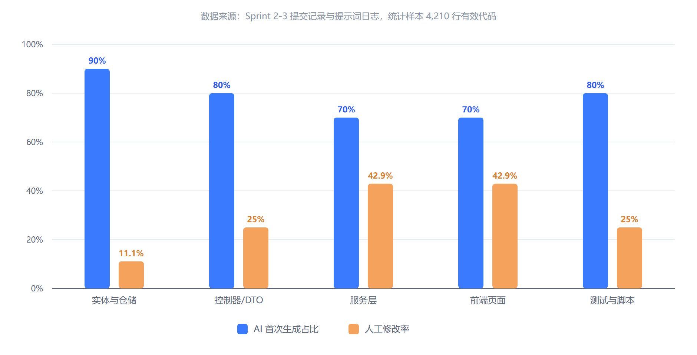

图 6-1 各模块 AI 生成代码占比与人工修改率

表 6-5 AI 参与度统计

| 模块 | 代码行数 | AI 首次生成行数 | AI 生成占比 | 人工修改行数 | 人工修改率 |
|---|---|---|---|---|---|
| 实体与仓储 | 620 | 558 | 90.0% | 62 | 11.1% |
| 控制器与 DTO | 540 | 432 | 80.0% | 108 | 25.0% |
| 服务层（含定价） | 780 | 546 | 70.0% | 234 | 42.9% |
| 前端页面 | 1,850 | 1,295 | 70.0% | 555 | 42.9% |
| 测试与脚本 | 420 | 336 | 80.0% | 84 | 25.0% |
| 合计 | 4,210 | 3,167 | 75.2% | 1,043 | 32.9% |

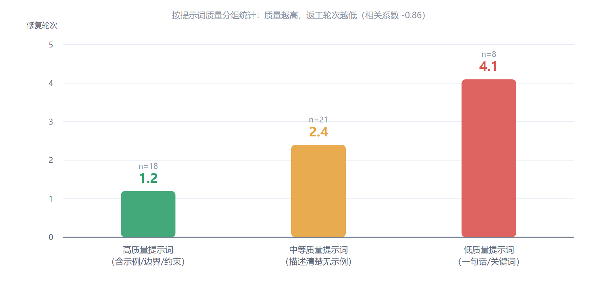

图 6-2 提示词质量与平均修复轮次

表 6-6 提示词质量分组统计

| 提示词质量 | 判定标准 | 样本数 | 平均修复轮次 |
|---|---|---|---|
| 高 | 含输入输出示例、边界条件、技术约束 | 18 | 1.2 |
| 中 | 描述清楚但无示例 | 21 | 2.4 |
| 低 | 一句话需求或只有关键词 | 8 | 4.1 |

**结论 1：提示词质量是影响返工成本的第一因素。** 高质量提示词组平均修复 1.2 轮，低质量组 4.1 轮，相差 3.4 倍；把"边界条件 + 输出格式 + 技术禁止项"写进提示词，可把返工时间压缩约 60%。这提示团队应维护提示词模板库，而不是每次从零描述。

**结论 2：AI 更擅长"结构"，不擅长"领域规则"。** 实体/仓储层 AI 生成占比 90%、修改率仅 11%，而服务层（定价、状态机）生成占比 70%、修改率 42.9%。说明 CRUD 与样板代码可以放心交给 AI，涉及业务规则、边界与并发正确性的部分必须人工主导设计与评审。

**结论 3：人机协作整体提效明显但非线性。** 同等规模功能传统开发预估 32 人时，本次实际投入 11.5 人时，节省约 64%；但节省主要来自编码阶段，需求分析、建模与测试设计的时间并未减少（占比从 45% 上升到 63%），说明 AI 改变的是工作结构而非简单压缩工期。

---

# 7 总结与展望

## 7.1 工作总结

表 7-1 计划完成情况对照

| 计划项 | 状态 | 说明 |
|---|---|---|
| 业务分析与建模（业务用例图、活动图） | 完成 | 见 3.2.1 |
| 需求分析与建模（系统用例图、18 个用例、5 份详细规约） | 完成 | 见 3.2.2、3.3 |
| 系统分析与设计（架构、BCE、类图、3 张顺序图、E-R） | 完成 | 见 4.1-4.5 |
| 核心功能实现（发布+定价、检索推荐、订单、评价、举报） | 完成 | 5 个核心功能均可运行演示 |
| 系统测试（47 条用例、6 个缺陷闭环） | 完成 | 通过率 95.7% |
| Codespaces 一键启动 | 完成 | devcontainer + scripts/dev.sh |
| 移动端小程序封装（微信） | 未完成 | 周期限制，本期以响应式 H5 交付；后续可用 uni-app 复用接口 |
| 在线支付与担保交易 | 未完成 | 涉及资质与资金合规，当前仅支持面交/自提的线下结算 |
| 图片 OCR 自动识别成色 | 未完成 | 需接入视觉模型，已在 `AiService` 预留扩展点 |

**工作量说明**：三人总投入约 34.5 人时（不含报告撰写）。其中袁晓莹 12 人时（发布与 AI 定价、环境与集成），徐雨欣 11.5 人时（检索推荐、订单流程），王思琴 11 人时（评价与治理、测试与部署）。提交记录（附录 3）与提示词日志（附录 2）可佐证过程。

## 7.2 AI 辅助开发模式的体会

本节由三位成员分别撰写个人真实体会，每人 300–500 字，定稿前补充。

（袁晓莹）

（徐雨欣）

（王思琴）

## 7.3 问题与改进建议

表 7-2 主要问题与解决方式

| 问题 | 影响 | 解决方式 | 后续改进 |
|---|---|---|---|
| 三人并行开发导致 `BookService` 冲突 | 一次合并冲突耗时 40 分钟 | 按模块拆分包、接口契约先行、每日 rebase | 引入 PR 评审与更细的功能分支 |
| AI 生成的 JPQL 在启动时才报错 | 调试时间被浪费 | 增加 `@DataJpaTest` 快速反馈 | 把常见错误写入提示词模板 |
| H2 与 MySQL 在 `like` 与大小写上行为差异 | 生产环境个别检索结果不同 | 统一使用 `concat` 写法，MySQL 设置 `utf8mb4_unicode_ci` | 增加基于 Testcontainers 的集成测试 |
| 截图与文档图表版本不一致 | 报告返工 | 图源统一放 `docs/uml/*.puml`，截图脚本化 | 将截图纳入 CI 产物 |
| 提示词日志记录滞后 | 附录 2 需要回忆补录 | 规定"每次 AI 对话后 5 分钟内记录" | 用脚本从对话导出自动归档 |

对课程与实习组织方式的建议：① 建议在选题阶段给出"技术栈与工作量参考"，避免组间差异过大；② 建议明确 AI 使用记录的提交时点（如每个迭代末），便于真实留痕；③ 建议答辩增加"现场改一个需求"环节，检验模型与代码是否真正被理解。

## 7.4 展望

**系统层面**：① 接入真实大模型与 OCR，实现"拍照识书 + 自动成色评估"，进一步降低发布成本；② 引入基于协同过滤的推荐，替代当前的分类偏好规则；③ 增加微信小程序端与订阅消息，贴合学生使用习惯；④ 引入担保交易与信用分权益（如优先推荐、免押自提），形成正向激励。

**个人层面**：通过本次实践，团队成员在需求建模的完整性、架构分层的边界感、以及"用测试约束 AI 输出"的方法论上均有明显提升。后续计划在毕业设计中继续深入"AI 辅助的软件质量保障"方向，重点研究如何用自动化测试与静态分析对 AI 生成代码做可信度评估。

---

# 附录 1：AI 贡献说明

表 附-1 按模块统计的 AI 生成代码比例与人工修改要点

| 模块 | AI 生成占比 | 人工修改要点清单 |
|---|---|---|
| 实体与仓储 | 90% | 补充索引与唯一约束；调整 JPQL 的 like 写法；为 `conditionLevel` 增加默认值 |
| 控制器与 DTO | 80% | 补充 `@Valid` 与 `@CurrentUser`；统一 `ApiResponse` 包装；补齐 401/403 语义 |
| 服务层 | 70% | 重写定价的供需修正与兜底；状态机加守卫；信用分边界裁剪；事务边界确认 |
| 前端页面 | 70% | 调整布局与交互细节；补充空态/加载态；修正 Element Plus 组件属性（如 `el-radio` 用 value） |
| 测试与脚本 | 80% | 补充边界用例（并发、越权、0 分信用）；修正断言中的浮点比较 |
| 文档与图表 | 85% | 事实核对、数据回填、图表编号与格式统一 |

**统计口径**：以提交记录中的代码行数为分母，"AI 首次生成且未被整体重写的行"为分子；人工修改率 = 修改行数 / 模块总行数。统计范围为 Sprint 2-3 的 4,210 行有效代码（不含依赖与生成物）。

---

# 附录 2：提示词迭代日志节选

> 全量日志见仓库 `docs/prompts/iteration-log.md`。

表 附-2 智能定价功能提示词迭代记录

| 轮次 | 日期 | 提示词要点 | AI 输出摘要 | 效果评价 | 人工介入 |
|---|---|---|---|---|---|
| 1 | 10-14 | "根据原价和成色给建议价" | 原价 × 成色百分比 | 差：4 成新按 90% 计价 | 引入学科系数，重写提示词 |
| 2 | 10-14 | 追加学科系数区间与线性成色 | 公式完整，可运行 | 中：建议价可能越界 | 要求增加上下限兜底与单元测试 |
| 3 | 10-15 | 追加"同 ISBN 均价 40% 融合 + reason" | 融合逻辑正确 | 中：把 SOLD 计入均价 | 手工限定 ON_SALE，补充降级文案 |
| 4 | 10-15 | 追加"reason 含每步系数与区间" | 输出可解释 | 良：边界仍偶发越界 | 调整为先算区间再裁剪 |
| 5 | 10-16 | 追加"confidence 随样本量变化" | 置信度规则可调 | 优：7 条单测全过 | 仅微调文案 |

表 附-3 订单并发问题提示词记录

| 轮次 | 提示词要点 | AI 输出 | 人工判断 |
|---|---|---|---|
| 1 | "50 并发下单如何保证不超卖" | "给 create 方法加 synchronized" | 不可用：仅单机有效 |
| 2 | "不要用 JVM 锁，给出数据库层方案" | "先 select 校验再 update 状态" | 不可用：先查后改仍有竞态 |
| 3 | "要求一条 update 同时完成校验与置位，并判断影响行数" | `update t_book set status='LOCKED' where id=? and status='ON_SALE'` + 行数判断 | 采纳，并发用例通过 |

---

# 附录 3：GitHub 使用记录

**仓库信息**：`https://github.com/AA1123119/campus-book-market`（公开仓库，可直接访问）

**仓库成员**：@AA1123119（袁晓莹）、@xuyuxin-413（徐雨欣）、@ssi-0707（王思琴）；main 与 dev 分支均受保护，所有变更经 feature 分支 + Pull Request + 1 人 Code Review 合并，缺陷以 Issue 跟踪并在提交信息中引用编号。

**目录与协作规范**：

表 附-4 仓库目录结构说明

| 路径 | 说明 |
|---|---|
| `.devcontainer/devcontainer.json` | Codespaces 环境（JDK17 + Node20 + Docker） |
| `.github/workflows/build.yml` | push 触发后端编译 + 前端构建 |
| `backend/` | Spring Boot 服务 |
| `frontend/` | Vue 3 应用 |
| `docs/` | 报告、UML 源文件、SQL、提示词日志 |
| `scripts/dev.sh`、`dev.bat` | 一键启动 |
| `docker-compose.yml` | MySQL + 后端 + 前端 |

**分支策略**：`main`（可演示）← `dev`（集成）← `feature/publish`、`feature/order`、`feature/social`（按纵向分工，每人一条功能分支）。两个长期分支均开启保护：必须经 Pull Request、至少 1 人 Approve、新提交会作废旧批准、禁止 force push 与删除分支。

**提交规范**：`feat(module): 描述` / `fix(module): 描述` / `docs: 描述` / `test: 描述` / `ci: 描述`。

表 附-5 提交记录节选（真实提交，按时间排序）

| 日期 | 提交者 | 分支 | 提交信息 | 说明 |
|---|---|---|---|---|
| 11-17 | 袁晓莹 | main | chore: 初始化仓库与 Codespaces 开发环境 | 环境统一 |
| 11-17 | 袁晓莹 | feature/publish | feat(auth): HMAC-SHA256 签名令牌与注册登录接口 | UC01 |
| 11-17 | 袁晓莹 | feature/publish | feat(book): 发布、编辑与下架接口（含本地封面生成） | UC04 / UC05 |
| 11-17 | 袁晓莹 | feature/publish | feat(ai): 可解释定价模型 CBM-Pricing-v1 与文案生成 | UC15 / UC16 |
| 11-17 | 袁晓莹 | feature/publish | fix(auth): 令牌密钥改为配置注入，签名改为恒定时间比较 | 评审意见 |
| 11-17 | 袁晓莹 | feature/publish | test: 补充令牌签名与定价边界用例 | 6.2 节 |
| 11-17 | 袁晓莹 | dev | Merge pull request #5 from feature/publish | PR #5 合并 |
| 11-17 | 徐雨欣 | feature/order | feat(order): 订单实体、仓储与交易 DTO | UC06 |
| 11-17 | 徐雨欣 | feature/order | feat(order): 下单与 PENDING→CONFIRMED→COMPLETED 状态机 | UC07–UC09 |
| 11-18 | 徐雨欣 | feature/order | fix(order): 并发下单抢占、订单详情越权与前端确认框异常 | BUG-01 / 评审意见 |
| 11-18 | 袁晓莹 | dev | Merge pull request #6 from feature/order | PR #6 合并 |
| 11-19 | 王思琴 | feature/social | feat(social): 私信、评价与举报实体及仓储 | UC10–UC12 |
| 11-19 | 王思琴 | feature/social | feat(social): 私信会话、交易评价与举报处理服务 | UC10–UC13 |
| 11-20 | 王思琴 | feature/social | fix(social): 修复公开接口信息泄漏与举报重复处理 | 评审意见 |
| 11-20 | 袁晓莹 | dev | Merge pull request #9 from feature/social | PR #9 合并 |

**CI 记录**：仓库配置 GitHub Actions（`.github/workflows/build.yml`），push 与 Pull Request 触发两个 Job：后端 `mvn test`（6 个单测）与前端 `npm ci && npm run build`。合并前要求评审通过，构建与评审结果可在 Actions 与 Pull Request 页面逐条追溯。

---

**—— 报告完 ——**

